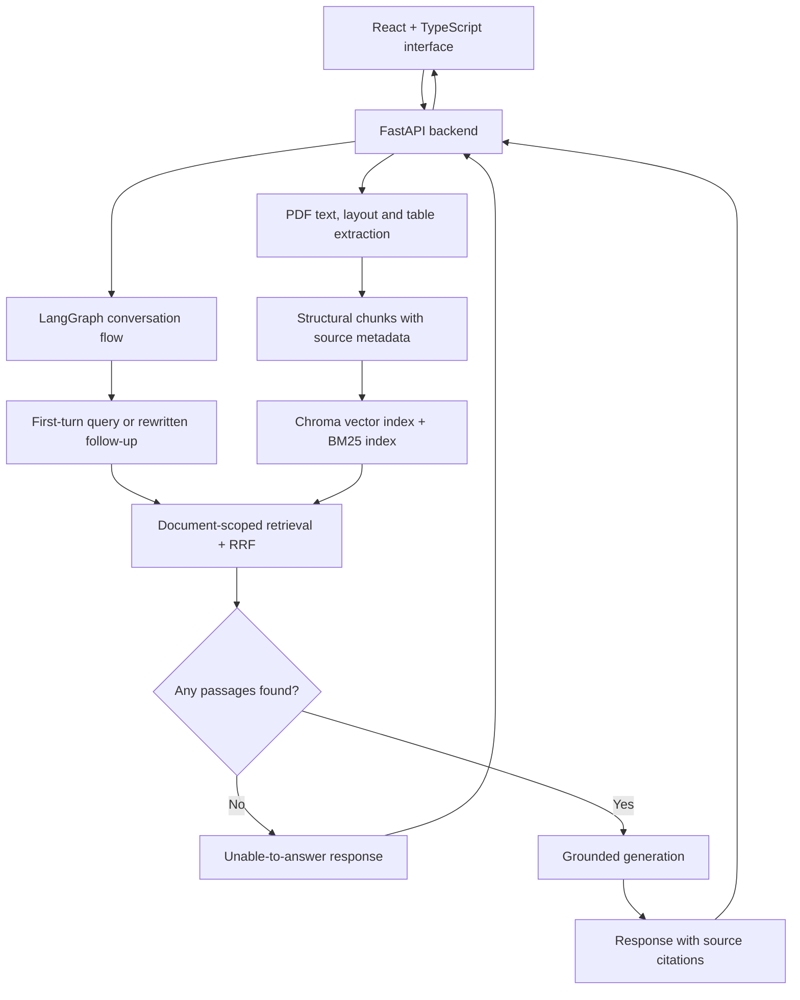

# Personal RAG Assistant

A personal assistant for working with PDF documents.

The interface supports PDF uploads, document selection, saved conversations
and inspection of source citations.

## System architecture

The backend preserves PDF layout and tables, then stores chunks with their
document and page metadata. Retrieval combines Chroma and BM25 results using
Reciprocal Rank Fusion (RRF).

LangGraph coordinates the conversation. The first turn uses the original
question; later turns use a rewritten search query. Empty retrieval returns
an inability response. Otherwise, the generation path uses retrieved passages
and maps citation references to their sources.

## Technology

- Backend: Python and FastAPI
- Frontend: React and TypeScript
- PDF processing: PyMuPDF and pdfplumber
- Retrieval: Chroma and BM25
- Conversation flow: LangGraph

## Status

The application is deployed with a hosted frontend and a local backend.

**Website:** [Personal RAG Assistant](https://personal-rag-assistant-ymwon04.pages.dev/)

Access requires an invitation. Contact the administrator or the person who shared this website to request an invitation link.
