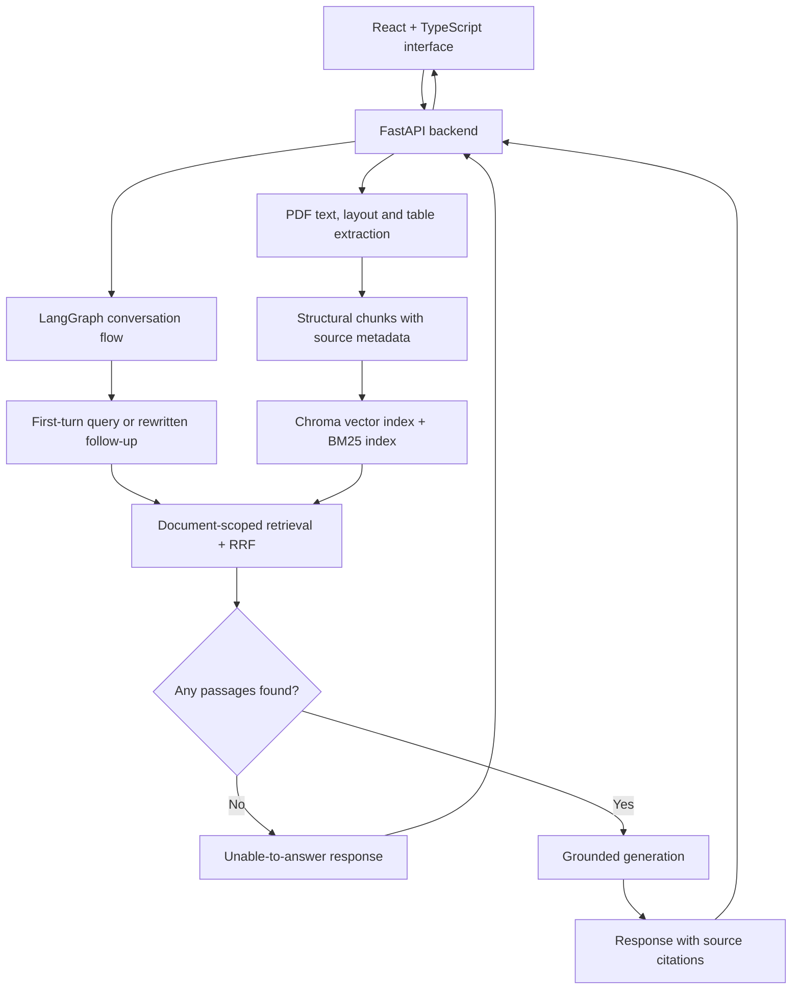
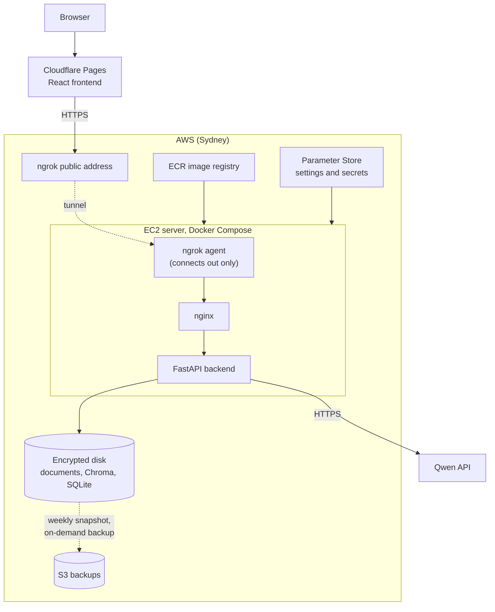
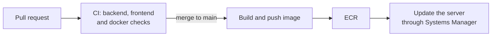

# Personal RAG Assistant

A personal assistant for working with PDF documents.

The interface supports PDF uploads, document selection, saved conversations
and inspection of source citations.

## System architecture

The backend preserves PDF layout and tables, then stores chunks with their
document and page metadata. Retrieval combines Chroma and BM25 results using
Reciprocal Rank Fusion (RRF).

LangGraph coordinates the conversation. The first turn uses the original
question; later turns use a rewritten search query. Empty retrieval returns
an inability response. Otherwise, the generation path uses retrieved passages
and maps citation references to their sources.

## Technology

- Backend: Python and FastAPI
- Frontend: React and TypeScript
- PDF processing: PyMuPDF and pdfplumber
- Retrieval: Chroma and BM25
- Conversation flow: LangGraph
- Cloud: AWS (EC2, ECR, S3, Systems Manager), Docker Compose, Cloudflare Pages
- Delivery: GitHub Actions and Terraform

## Deployment

- **No open ports.** The server has no inbound rules and no SSH. The tunnel
  connects outward, and administration goes through AWS Systems Manager.
- **Infrastructure as code.** Terraform defines the server, registry, backup
  bucket, snapshot policy and least-privilege access.
- **Continuous integration.** Three required checks (backend, frontend, docker)
  must pass before a pull request can merge into `main`.
- **Continuous delivery.** Each merge to `main` builds an immutable image tagged
  with the commit, pushes it to the registry and updates the running server.
- **On-demand server.** Start and stop buttons (GitHub Actions) keep the cost low.
  The server also stops itself after three hours.
- **Secrets stay out of the repository.** API keys live in Parameter Store and are
  read by the server at start-up.
- **Backups.** The data disk is snapshotted weekly, and a script saves a
  checksummed copy to a private bucket that can be restored on a laptop.

## Status

The backend runs on AWS and the frontend on Cloudflare Pages.

**Website:** [Personal RAG Assistant](https://personal-rag-assistant-ymwon04.pages.dev/)

**Live demo available on request.** The server runs on demand to keep costs low,
and access requires an invitation. Contact the administrator or the person who
shared this website to have the demo started and to receive an invitation link.
